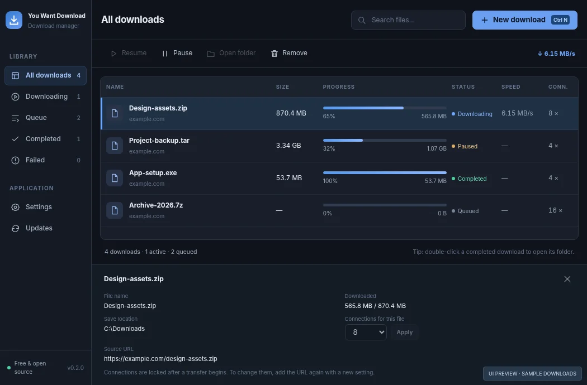

<div align="center">

# You Want Download

**A compact, free, MIT-licensed Windows download manager.**

Parallel HTTP(S) downloads · Queue · Pause/resume · Per-file connections · Portable and installer

[Download releases](https://github.com/kavianpcx/You-Want-Download/releases) · [Report a bug](https://github.com/kavianpcx/You-Want-Download/issues) · [Contribute](CONTRIBUTING.md)

</div>



*Screenshot from the actual HTML/CSS interface in Chromium with **clearly labeled sample downloads**. It is a UI preview, not an assertion that these transfers occurred or that the Windows executable was exercised on this Linux environment.*

## What's new in v0.2.0

The old v0.1 Electron dashboard was replaced with **Go + Wails/WebView2** to produce a much smaller standalone Windows executable. Instead of a hero banner, large statistic cards, and tiny action icons, the app uses a focused download table, a consistent icon system, a small toolbar, explicit settings, and a details pane.

- **Choose 1, 2, 4, 8, or 16 connections** for each new HTTP(S) download, with a separate **default** in Settings. The engine automatically limits segmentation when the file is small or the server doesn't support verified byte ranges. This is **not a guarantee of a speed increase**.
- **Pause, resume, queue, schedule:** streaming to safe temporary segment files, preserving disk progress through an app restart. If a server doesn't support byte ranges, a partial transfer restarts safely from zero.
- **Concurrent files:** choose 1–8 simultaneous downloads; older queued tasks start first.
- **Details and actions:** file size, bytes written, progress, transfer rate, connection count, URL, destination; change connections on jobs that haven't started; open completed downloads in Explorer; remove a task without deleting the final file.
- **Search and filters:** all, downloading, queued/paused, completed and failed.
- **Simpler Windows distribution:** portable `.exe` and per-user NSIS installer. Uses the Windows WebView2 Runtime instead of bundling an entire Chromium browser. On a machine without WebView2 the application offers the Microsoft bootstrapper.
- **Older-download migration:** best-effort import of the previous Electron `downloads.json` from its Windows roaming application-data folder, keeping original download files untouched.
- **Updates:** a manual GitHub Releases version check from within the app.

> **No feature-parity claim with Internet Download Manager (IDM) or Free Download Manager (FDM).** HTTP/HTTPS and reliable transfers are the implemented scope. Torrent/magnet links, browser-wide interception, video-site capture, proxy profiles, speed limits, individually named recurring queues, and automatic *differential* patch updates are **not** implemented in v0.2.0. The legacy browser extension is not compatible with this rewrite yet.

## Install

Go to **[Releases](https://github.com/kavianpcx/You-Want-Download/releases)** and choose:

| File | Behavior |
|---|---|
| `You-Want-Download-0.2.0-x64-Setup.exe` | Per-user installer, Start Menu shortcut and uninstall entry |
| `You-Want-Download-0.2.0-Portable.exe` | Single executable; no installer required |

Windows 10/11 x64 and Microsoft WebView2 Runtime are required. The runtime is already installed on most modern Windows systems; Wails can offer Microsoft's bootstrapper if needed. Both executables use your Windows user profile for settings and download queue, so moving the portable exe does not move its history. The releases are **not code-signed**; Windows SmartScreen can warn.

**Do not overwrite a currently running v0.1 installation with v0.2.** Close the previous application first. Because v0.2 changes desktop frameworks, installing v0.2 is a manual upgrade; the v0.1 differential updater is not compatible with v0.2.

## How downloads work

1. Click **New download** or press **Ctrl+N**.
2. Paste a direct HTTP or HTTPS link, optionally select a name, folder and start time.
3. Select **Connections per file** (1/2/4/8/16), then **Start download**.
4. Select a row to see details, pause/resume, or reveal the finished file.
5. Under **Settings**, choose the default number of connections and concurrent downloads.

The downloader checks the server's `Content-Range`, file length and ETag/Last-Modified validator where available; stores segment data in `.ywd-<id>-<segment>.part`; verifies the resulting byte count; and assembles into a temporary file before moving it into place. It avoids overwriting a previously existing target. The size check is not the same as a publisher-provided cryptographic SHA-256 checksum.

## Build from source

Requires Go 1.23+ (CI uses Go 1.24), Node.js 22+, and [Wails v2](https://v2.wails.io/docs/gettingstarted/installation/). Windows builds require a C compiler and WebView2 development tooling available in the Wails build process. [NSIS](https://nsis.sourceforge.io/) builds the installer.

```sh
# Download engine tests (no Wails runtime required)
go test -race -count=1 ./internal/downloader

# Validate the small dependency-free frontend
cd frontend && npm install && npm run build && cd ..
node --check frontend/dist/app.js

# Windows portable executable (from Windows with Wails CLI installed)
go install github.com/wailsapp/wails/v2/cmd/wails@v2.10.1
wails build -platform windows/amd64 -webview2 embed -o You-Want-Download.exe
```

For local menu/UI smoke tests, install Python Playwright and Chrome/Chromium, then run `python tests/ui_smoke.py`. This script tests navigation, settings, dialogs, connections-per-file, selection, queue actions and search with **sample data**, independently of the Go transfer engine. The Go tests start local HTTP servers and compare the **actual downloaded bytes** to their originals.

CI (`.github/workflows/release.yml`) runs Go race/correctness tests, checks frontend JavaScript and UI behavior, builds the Windows portable executable and installer, checks the artifacts and a maximum binary size budget, and publishes a new version **only if every job succeeds**. Windows packaging, GUI execution inside Windows, and updates across two releases still require field validation; passing unit tests alone cannot prove compatibility with every server or Windows configuration.

## Updates and size

Unlike the Electron 0.1 updater, this v0.2 rewrite **does not claim to install incremental patches**. Its Updates menu checks the latest version on GitHub and opens the release page for an authenticated-by-the-user manual download. A future signed and verified delta updater would need its own tests, rollback logic, and patch manifests. Full replacements are safer until that mechanism is complete.

Download history is stored under your Windows user configuration folder (`YouWantDownload/downloads.json`); no account, ads or telemetry are required. Networking occurs only to user-supplied URLs and, when requested, the GitHub Releases API. Browser integration and additional protocols remain open-source roadmap items, not implemented features.

## License

[MIT](LICENSE). Free for personal and commercial use. Not affiliated with IDM or FDM; no proprietary code or assets from either product are used.
