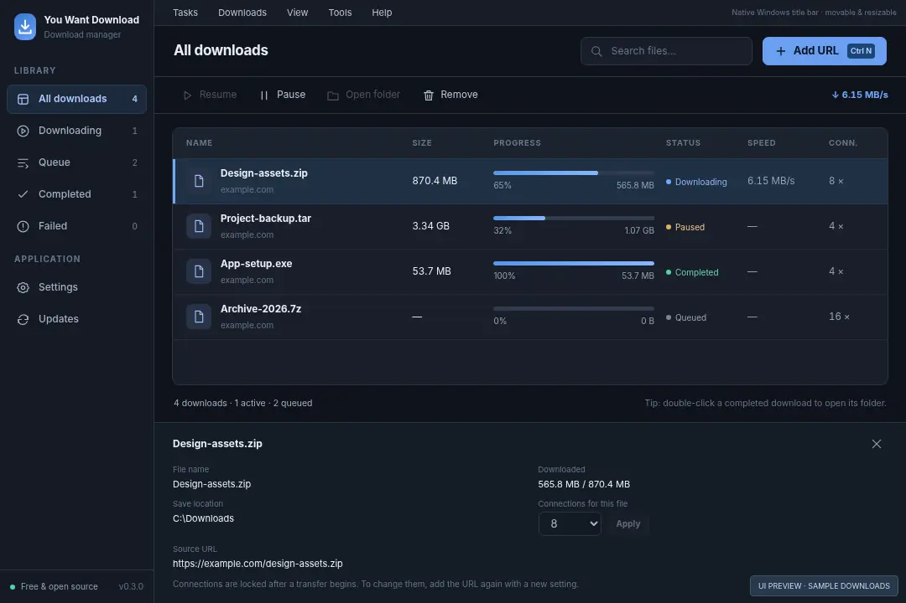

<div align="center">

# You Want Download

**A compact, free, open-source download manager for Windows.**

Parallel HTTP/HTTPS · Resume · FIFO queue · Clipboard Add URL · Multiple network adapters · Installer and portable

[**Download for Windows**](https://github.com/kavianpcx/You-Want-Download/releases/latest) · [Report a problem](https://github.com/kavianpcx/You-Want-Download/issues) · [MIT License](LICENSE)

</div>



*Screenshot of the actual shipped HTML/CSS interface exercised in Chromium with **sample transfers**, not an image of a live download or a screenshot of the Windows frame. The Windows app uses the **standard OS title bar** with the window icon and minimize, maximize, and close buttons.*

## Download / install

| Windows 10 / 11 x64 | File |
| --- | --- |
| Installer, user-selectable installation folder, Start Menu and uninstall entry | `You-Want-Download-0.3.0-x64-Setup.exe` |
| Standalone portable program, no installation | `You-Want-Download-0.3.0-Portable.exe` |

Get these from [GitHub Releases](https://github.com/kavianpcx/You-Want-Download/releases). Microsoft **WebView2** is required; most current Windows systems have it. Binaries are **not digitally signed**, so Windows SmartScreen may show a warning. No accounts, advertising or telemetry.

**Updating from v0.2:** quit the older app, then install v0.3. Your saved downloads and user data stay in the same Windows profile location. The in-app **Updates** menu checks GitHub Releases and opens the release page. **Automatic differential patch installation is not implemented yet.**

## The simple workflow

1. **Copy** a direct `https://...` or `http://...` file URL.
2. Open You Want Download, click **Add URL** (`Ctrl+N`). The URL is **prefilled from the clipboard**, if valid and enabled in Settings.
3. Click **Start download**. The app chooses the filename, destination folder, and connection count from your saved settings automatically.
4. **Advanced options** is optional: change file name, destination, start time, or number of connections for this one file.

There is no continuous background clipboard watcher. The clipboard is read only when Add URL opens (or when you explicitly use **Tasks → Add from clipboard**, `Ctrl+Shift+V`). The app rejects clipboard content that is not a valid HTTP(S) URL. Only HTTP and HTTPS downloads are supported.

## v0.3 options, inspired by the useful parts of IDM

The native Windows caption, app icon, system menu, window dragging, resizing, minimize/maximize and close controls are provided by Wails/WebView2. The compact in-app menu bar has working **Tasks / Downloads / View / Tools / Help** menus.

Under **Tools → Options / Settings**:

| Tab | Options and behavior |
| --- | --- |
| **General** | Auto-fill the Add URL box from clipboard on opening. |
| **Connection** | Save **1, 2, 4, 8 or 16 default connections per file**, choose **System default** or **Combine adapters**, and select available IPv4 network adapters. |
| **Save To** | Default download folder; optionally store downloaded software installers (`.exe`, `.msi`, `.msix`, `.appx`) in their own directory. Does **not** silently install software or change Windows' installed-program paths. |
| **Downloads** | 1–8 concurrent downloads; 0–5 retries for each failed segment. FIFO queue. |
| **Proxy / SOCKS** | Optional `http://`, `https://`, or `socks5://` proxy URL without credentials. Empty means use proxy environment settings. |

Settings are **persisted** in `downloads.json` and are used by all **new** downloads. Existing files keep the connection count they started with, preventing corrupted partial downloads. Individual tasks can override the default **before** downloading starts.

IDM has additional features (site logins, FTP, browser capture, video integration, category rules, sounds, advanced queue scheduler) that are **not present here**. This is independent MIT-licensed software, not IDM code or a visual copy.

## Two Internet connections: how it works and its limits

For one file, set **Settings → Connection → Combine adapters**, tick two physical adapters (for example **Wi-Fi + USB tethering** or **Wi-Fi + Ethernet**), and save. If you select none, all eligible active IPv4 adapters are considered. Each piece of a large HTTP(S) download is fetched over its own TCP connection, *explicitly pinned to its Windows network adapter*, with `IP_UNICAST_IF` and the adapter's local IPv4 address. Requests are assigned round-robin, and failed transfers can retry on another route. The downloaded bytes are checked and assembled in order. The application does **not** change Windows' system-wide routes or require administrative permissions.

This is **connection-level load spreading**, not true packet-level bonding: a single TCP transfer cannot use two links at once. The destination server must support HTTP byte ranges for multiple segments, both adapters must actually have working Internet access, Windows must allow simultaneous connections, and the remote file must have consistent metadata (ETag or Last-Modified) across routes to mix their data safely. If its metadata cannot be verified, the downloader uses one viable route for safety. The active interface list can include virtual adapters and VPNs; select known Internet uplinks. Some servers throttle per user, block multiple IPs, disallow ranges, or supply different content to different networks. **There is no promise of 2× speed.** Real two-ISP performance must be measured with both links connected on a Windows computer.

The network-routing approach was researched against the open-source projects [ADM](https://github.com/StrStark/advance-download-manager) (Go per-link dial control) and [DualBond](https://github.com/bhutano/DualBond) (Windows socket `IP_UNICAST_IF`). No source files from those projects were copied. This implementation is independently written and licensed under MIT.

## Download safety and reliability

- Up to 16 HTTP byte-range parts per file, automatically scaled down for small files and non-range servers.
- Pause/resume, restart recovery, scheduled start (per download), download queue and search/filters.
- Partial `.part` files are never exposed as finished downloads. Assembly uses a temporary destination, syncs, and then renames without overwriting an existing target.
- Validates HTTP status, `Content-Range` and length; checks ETag/Last-Modified when present, and refuses to mix incompatible responses across adapters.
- Does not execute downloaded programs or change Windows installation paths.
- **Not** a content antivirus or cryptographic checksum verifier; verify important downloads with a publisher's SHA-256 when provided.

## Build and test

Stack: Go 1.23+ (CI runs Go 1.24), Wails v2, Microsoft WebView2, static JavaScript/CSS UI with no frontend runtime dependencies, NSIS installer. The Windows shell replaces the much larger Electron-based v0.1 and keeps v0.2's compact architecture.

```bash
# Actual HTTP server / filesystem / route integration and data-corruption tests:
go test -race -count=1 ./internal/downloader

# Static UI syntax and Chromium click-through (requires playwright + Chromium):
node --check frontend/dist/app.js
python tests/ui_smoke.py

# Windows-only: after installing Wails CLI and dependencies:
go install github.com/wailsapp/wails/v2/cmd/wails@v2.10.1
wails build -platform windows/amd64 -webview2 embed -o You-Want-Download.exe
```

[GitHub Actions](.github/workflows/release.yml) gates the release on Go Linux race tests, tests on Windows, browser UI interaction tests, Windows binary packaging, and maximum portable size. The UI test exercises navigation, all five top menus, clipboard prefill, a simple Add URL dialog, settings tabs, adapter selection, saving settings, and download actions against a **mocked OS bridge**. The download engine is separately tested with **real HTTP test servers**, including two independent routed HTTP clients and a retry simulation. Neither test invents a measured live dual-ISP acceleration result. A Windows GUI startup/native-caption smoke check runs when the CI runner has an interactive desktop; verify the installer and adapter speeds on real Windows hardware too.

## What this version does not claim

Automatic in-place/differential patch updates, BitTorrent/magnets, browser-wide interception, adaptive video capture, SOCKS credentials, Windows startup integration, and full IDM/FDM feature parity are not available. Please [open an issue](https://github.com/kavianpcx/You-Want-Download/issues) for requests or bugs. See [CONTRIBUTING.md](CONTRIBUTING.md).

## License

[MIT](LICENSE) — free to use, share and improve. Not affiliated with Internet Download Manager or Free Download Manager.
