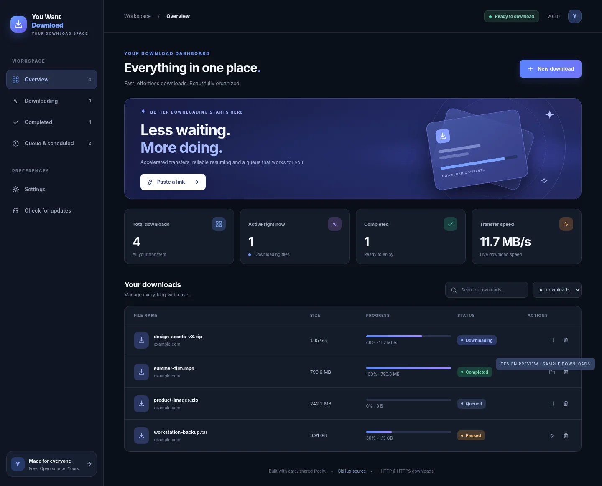

<div align="center">
  <h1>⬇️ You Want Download</h1>
  <p><strong>A modern, free and open-source Windows download manager.</strong></p>
  <p>HTTP(S) acceleration · Pause & resume · Smart queue · Scheduling · Portable or installed</p>
  <p><a href="https://github.com/kavianpcx/You-Want-Download/releases">Download latest release</a> · <a href="https://github.com/kavianpcx/You-Want-Download/issues">Report a problem</a> · <a href="CONTRIBUTING.md">Contribute</a></p>
</div>



<sub>UI screenshot rendered from the application's actual HTML/CSS using sample data for design preview. It does **not** represent a live transfer or a verified Windows installer.</sub>

## What works in v0.1.0

- **Real HTTP and HTTPS transfers** with streaming to disk, redirects, retries and HTTP error reporting.
- **Multi-connection downloads** when the server supports `Range` requests and provides a valid file size. Up to 8 concurrent downloads and 8 connections per file.
- **Pause and resume** with individual on-disk segments and crash/restart recovery when server-side byte ranges are supported. Servers without ranges safely restart a partial transfer instead of concatenating bad bytes.
- **Automatic queue** with configurable simultaneous downloads and optional future start time per download.
- **File management**: destination folder, safe file naming, filename collision avoidance, search and status filters, reveal completed files in Explorer.
- **Browser context menu extension** (Chromium-family browsers): right-click a link, select **Download with You Want Download**. Installs separately as an unpacked extension; uses the `ywd://` desktop protocol.
- **Installed-app updates**: in-app check, download progress, restart/install via GitHub Releases. The NSIS installer uses update blockmaps for **differential downloads** when the server and previous release permit it. A full-package fallback is possible.
- **Portable Windows build**: no installer required. Check updates manually using the application's Releases link; portable in-place differential updates are **not** implemented.
- A lightweight dark UI with restricted Electron preload bridge (`contextIsolation`, sandbox and no renderer Node.js integration).

> **Important:** This is an early working foundation, **not feature parity with Internet Download Manager or Free Download Manager**. Torrent/magnet support, video capture, DRM media downloading, site grabbing, FTP, automatic browser-wide interception, custom queues with individual policies, global bandwidth limits and automatic portable binary patching are not implemented. Do not rely on it for irreplaceable downloads before independent Windows verification.

## Download and install

Visit **[GitHub Releases](https://github.com/kavianpcx/You-Want-Download/releases)**. When a CI-validated release is published it should offer:

| Windows x64 artifact | Use |
| --- | --- |
| `You-Want-Download-<version>-x64-Setup.exe` | Normal installer; supports in-app delta updates |
| `You-Want-Download-<version>-Portable.exe` | Portable; manual app updates |

> Release packages are currently unsigned. Windows SmartScreen may warn about unknown publishers. Review the source and the GitHub Actions build workflow before executing.

## Run from source

Requires Node.js 22 or later and npm:

```sh
npm install
npm start
```

Run dependency-free engine tests and JS syntax validation:

```sh
npm run check
npm test
```

Build Windows x64 packages on Windows:

```sh
npm run dist:win
```

The GitHub Actions workflow runs tests before creating `.exe` packages, `latest.yml` and differential `.blockmap` artifacts. Versioned releases use the version in `package.json`. To publish a new release, increase that version and push to `main`; a matching tag is published only after the Windows build succeeds.

## Connect your browser (optional)

1. Install the normal Windows desktop app (this registers `ywd://`).
2. Open Chrome or Edge's **Extensions → Manage Extensions**, enable **Developer mode**, and select **Load unpacked**.
3. Select the `browser-extension/` folder. Right-click an HTTP(S) link and choose **Download with You Want Download**.

The browser may show a confirmation dialog before opening the desktop application. This extension does not automatically intercept browser downloads or capture media streams. Portable builds do not guarantee protocol registration.

## How updates work

The **installed** edition checks GitHub Releases when you click **Check for updates**. On a newer version you can download it and restart to install. `electron-updater` compares NSIS `.blockmap` data and can request **only the changed byte ranges**. If changed-block reuse is impossible (for example because a blockmap is unavailable), it falls back to downloading the full update. Update success and byte savings must be validated across two signed-off Windows releases, not inferred from configuration alone.

The **portable** edition offers a link to fetch the new portable executable manually. It does not silently replace itself or claim unsupported delta patching.

## Reliability and privacy

Downloads stream straight to `.ywd-*` temporary parts in the chosen folder. Segments are verified for the expected byte count, combined into a temporary file, checked against the server-reported total length, and then moved to the destination. Download state is written atomically to the app's local user-data folder. Completed files are never deleted by **Remove from list**.

This is **not a cryptographic integrity check**: if the publisher provides a SHA-256 checksum, compare it separately. Some servers do not support reliable resume or may invalidate URLs. The app does not transmit download history or analytics to us; requests go to the URLs you provide and update checks go to GitHub.

## Roadmap and known gaps

See [CONTRIBUTING.md](CONTRIBUTING.md) for development guidance. Near-term priorities: download correctness with hostile servers (unexpected gzip, broken ranges, mutable files); speed limits; named queues; proxies; localization including Persian RTL; native tray and notifications; comprehensive UI accessibility; automated Windows GUI smoke tests; checksum verification; optional torrent engine. Browser-wide download interception and media capture require a separate security and compatibility review.

## License

[MIT](LICENSE). Free for personal and commercial use. No affiliation with Internet Download Manager or Free Download Manager; their trademarks and proprietary code are not included.
